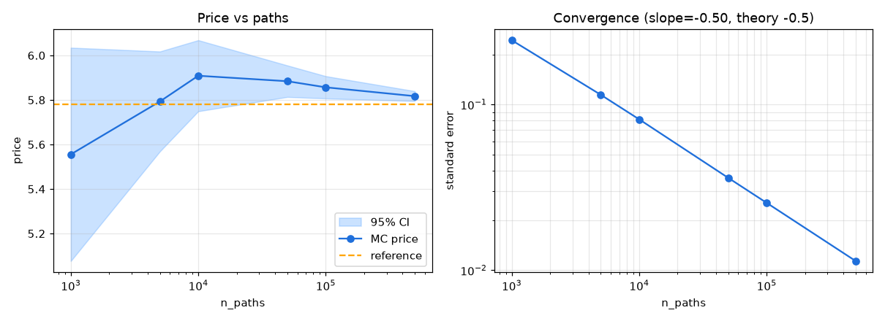

# exotic-options-mc

[](https://github.com/rxj0102/exotic-options-mc/actions/workflows/ci.yml)

[](https://www.python.org/)
[](LICENSE)
[](https://streamlit.io/)
[](#)

> **Institutional-grade Monte Carlo engine for exotic options with a full variance-reduction suite.**

A comprehensive Monte Carlo simulation engine for pricing path-dependent exotic
options — **Asian, Lookback, Barrier and Digital** — with a complete
variance-reduction toolkit (antithetic variates, control variates, stratified &
Latin-hypercube sampling, scrambled Sobol/Halton quasi-Monte Carlo, importance
sampling), convergence diagnostics, structured-product analytics and risk-
management tools. Packaged as a Python library and a live Streamlit dashboard.

---

## Quick start

```bash
git clone https://github.com/rxj0102/exotic-options-mc.git
cd exotic-options-mc
pip install -r requirements.txt

# Launch the interactive dashboard
streamlit run app.py

# Run the test suite
pytest -q
```

Price an Asian option in five lines:

```python
from simulation.gbm import GBMSimulator
from pricing.asian import AsianOptionPricer

paths = GBMSimulator(seed=42).generate_paths(S0=100, T=1.0, r=0.05, q=0.0, sigma=0.2,
                                             n_paths=100_000, n_steps=252)
result = AsianOptionPricer("continuous").price_arithmetic(paths, K=100, r=0.05, T=1.0, option_type="call")
print(result)   # arithmetic_asian: 5.80 +/- 0.01 (95% CI [...], n=100000)
```

---

## Feature matrix

| Option type | Monte Carlo | Analytical benchmark | Variance reduction | Greeks |
|-------------|:----------:|:--------------------:|:------------------:|:------:|
| Asian (arithmetic) | ✅ | geometric bound | ✅ (control variate) | ✅ |
| Asian (geometric)  | ✅ | Kemna-Vorst | ✅ | ✅ |
| Lookback (fixed/floating) | ✅ | Goldman-Sosin-Gatto | ✅ | ✅ |
| Barrier (8 types) | ✅ | Reiner-Rubinstein | ✅ | ✅ |
| Digital (4 subtypes) | ✅ | cash/asset/touch | ✅ | ✅ |
| Rainbow (multi-asset) | ✅ | — | ✅ | ✅ |
| Structured products | ✅ | component-based | ✅ | ✅ |

---

## Variance-reduction efficiency

Benchmarked on an at-the-money arithmetic Asian call
(S₀ = 100, K = 100, T = 1, r = 5%, σ = 20%, 50k paths). The variance-reduction
ratio is crude-MC variance ÷ method variance.

| Method | Price | StdErr | VR Ratio | Time (s) |
|--------|------:|-------:|---------:|---------:|
| Crude MC | 5.7357 | 0.03560 | 1× | 0.454 |
| Antithetic | 5.8081 | 0.01766 | 2× | 0.029 |
| Control Variate | 5.7823 | 0.00097 | **1337×** | 0.001 |
| Stratified | 5.8075 | 0.03582 | 1× | 1.531 |
| Sobol QMC (RQMC) | 5.7812 | 0.00106 | 1122× | 0.839 |
| Halton QMC (RQMC) | 5.7829 | 0.00135 | 696× | 1.243 |
| Antithetic + CV | 5.7824 | 0.00073 | 1207× | 0.157 |

> Reproduce with `python paper/generate_benchmarks.py`.

## Model validation

Monte Carlo prices versus closed forms (discrete-monitoring corrections applied):

| Instrument | MC price | Analytical | Dev. (bps) | z-score |
|------------|---------:|-----------:|-----------:|--------:|
| Geometric Asian call | 5.5624 | 5.5655 | −5.5 | −0.13 |
| Up-and-out barrier call | 1.1831 | 1.1761 | 60.0 | 0.72 |
| Floating lookback call | 17.2782 | 17.2168 | 35.7 | 1.33 |

---

## Convergence

Monte Carlo error decays as **O(N⁻¹ᐟ²)**; the engine recovers a fitted slope of
≈ −0.5 for `log(stderr)` vs `log(N)`. Quasi-Monte Carlo with a Brownian-bridge
construction achieves the sharper **O((log N)ᵈ / N)** rate.



*(Generate the plot via the Convergence Analysis tab or the deep-dive notebook.)*

---

## Model inventory

| Model | Volatility dynamics | Key parameters | Use case |
|-------|--------------------|----------------|----------|
| **GBM** | constant | σ | baseline / closed-form validation |
| **Heston** | stochastic, mean-reverting | κ, θ, ξ, ρ, V₀ | volatility smile / skew |
| **Merton Jump-Diffusion** | constant + jumps | λ, μ_J, σ_J | crash risk / fat tails |

---

## API overview

| Class | Module | Purpose |
|-------|--------|---------|
| `GBMSimulator`, `HestonSimulator`, `MertonJumpDiffusion` | `simulation/` | path generation |
| `AsianOptionPricer`, `LookbackOptionPricer`, `BarrierOptionPricer`, `DigitalOptionPricer` | `pricing/` | exotic pricing |
| `AntitheticVariates`, `ControlVariates`, `QuasiMonteCarlo`, `ImportanceSampling`, `CombinedVR` | `variance_reduction/` | variance reduction |
| `ConvergenceAnalyzer`, `CIEngine`, `EfficiencyAnalyzer`, `PathVisualizer` | `diagnostics/` | diagnostics |
| `MCGreeks`, `ExoticVaR`, `ExoticScenarioEngine`, `PnLAttribution` | `risk/` | risk management |
| `AutocallablePricer`, `SharkFinPricer`, `CapitalProtectedPricer`, `FXAccumulatorPricer` | `structured_products/` | structured notes |

Every pricer returns the uniform `MCResult` dataclass
(`price`, `stderr`, `ci_lower`, `ci_upper`, `n_paths`, `elapsed_seconds`, `method`).

---

## Math reference

**GBM exact discretization**

$$S_{t+\Delta t} = S_t \exp\!\Big((r - q - \tfrac12\sigma^2)\Delta t + \sigma\sqrt{\Delta t}\,Z\Big),\quad Z\sim\mathcal N(0,1)$$

**Geometric Asian (Kemna-Vorst)** — log-normal geometric average with
$\sigma_g = \sigma/\sqrt3$ in the continuous limit.

**Control-variate estimator**

$$\hat P_{cv} = \bar X - \beta\,(\bar C - \mathbb E[C]),\qquad \beta = \frac{\operatorname{Cov}(X,C)}{\operatorname{Var}(C)}$$

**Importance sampling (Girsanov)**

$$\mathbb E^{P}[f(S)] = \mathbb E^{\tilde P}\!\big[f(S)\,e^{-\theta W_T - \tfrac12\theta^2 T}\big]$$

**Convergence**

$$\text{Crude MC: } O(N^{-1/2}) \qquad\qquad \text{QMC: } O\!\big((\log N)^d / N\big)$$

---

## Repository layout

```
simulation/         GBM, Heston, Merton path generators + abstract base
pricing/            Asian, lookback, barrier, digital, rainbow, structured
variance_reduction/ antithetic, control, stratified, IS, QMC, combined
diagnostics/        convergence, confidence intervals, efficiency, visualisation
risk/               MC Greeks, VaR/CVaR, scenarios, P&L attribution
structured_products/ autocallable, shark-fin, capital-protected, FX accumulator
benchmarks/         analytical closed forms for validation
utils/              RNG, statistics, Plotly chart builders
tests/              pytest suite
notebooks/          guided deep-dive
paper/              ReportLab SSRN-ready PDF + benchmark generator
app.py              Streamlit dashboard (7 tabs)
```

---

## Paper

A methodology write-up — *Monte Carlo Methods for Exotic Options Pricing:
Path Dependency, Variance Reduction, and Structured Product Valuation* — is
generated by `python paper/generate_paper.py`. **SSRN:** _link placeholder_.

---

## License

MIT © [rxj0102](https://github.com/rxj0102)

## Validation notes

- **Knock-in put prices fixed.** The Reiner-Rubinstein case table had the up-and-in and down-and-in *put* branches wrong (call branches and all knock-outs were fine), so in + out did not equal the vanilla put. They now match Haug's table, and tests check in/out parity and Monte Carlo (Brownian-bridge) agreement for all eight barrier/option combinations.
- **Asian averaging dates** are now evenly spaced (`k*T/n`, ending at maturity) instead of starting at the first step, matching the Kemna-Vorst assumption. The control variate uses the number of averaging dates actually present in the paths, so its analytical mean matches the simulated control on coarse grids.
- `pytest` (run from the repo root; `pytest.ini` sets the path) and CI added. Re-running `paper/generate_benchmarks.py` after these fixes reproduced every price and error in `results/benchmark_results.json` (only wall-clock timings differ), so the stored numbers and the paper remain valid.
